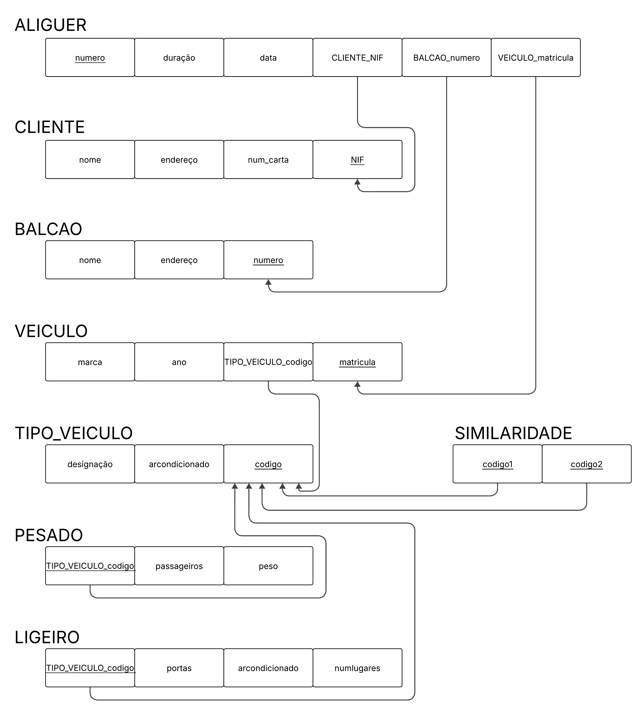
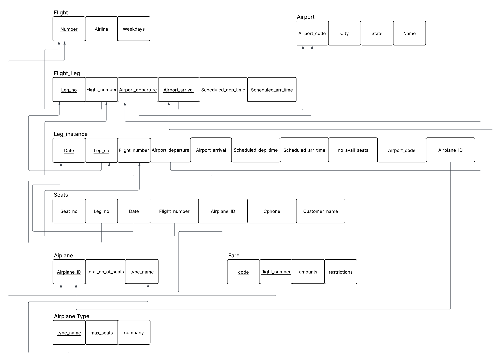
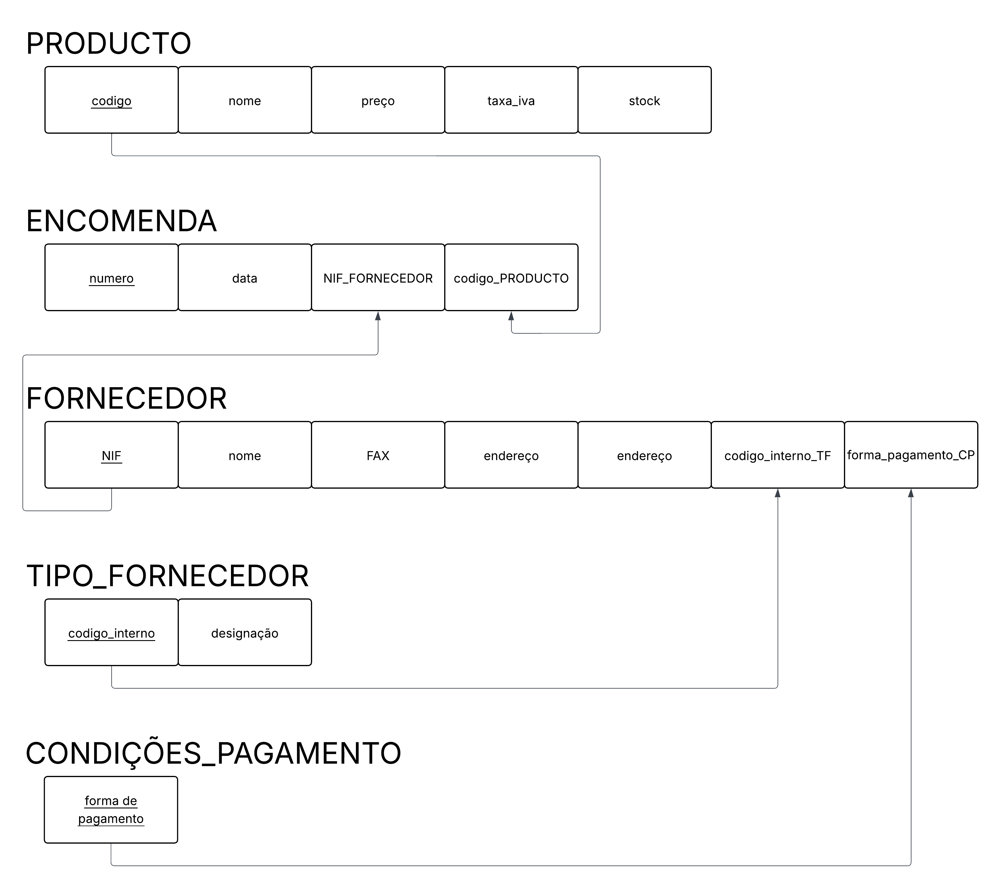
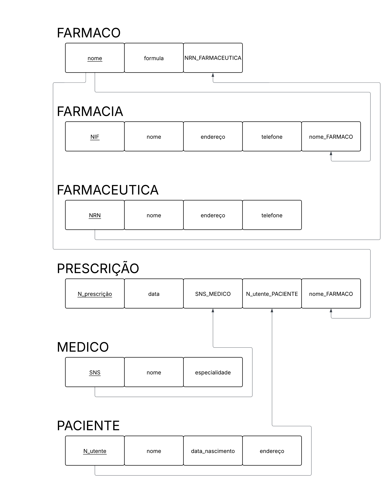

# BD: Guião 3


## ​Problema 3.1
 
### *a)*

```
Cliente(nome,endereço,num_carta,NIF)
Aluguer(data,duração,número)
Balcão(nome,endereço,número)
veículo(marca,ano,matrícula)
tipo_veiculo(designação,arcondicionado,código)
Ligeiro(numlugares,portas,combústivel)
Pesado(peso,passageiros)
Similaridade(código1,código2)
```


### *b)* 

```
chave Primária:
    - Cliente: NIF
    - Aluguer: número
    - Balcão: número
    - Veículo: matrícula
    - tipo_veículo: código
    - Ligeiro: tipoVeículo_código
    - Pesado: tipoVeículo_código
    - Similaridade: código1, código2
Chave estrangeira:
    - Aluguer: Cliente_NIF,Balcão_NUM,Veículo_MAT
    - Veículo: tipoVeiculo_código
    - Ligeiro: tipoVeículo_código
    - Pesado: tipoVeículo_código
    - Similaridade: código1, código2
Chave Candidatas:
    - Cliente(NIF,num_carta)
    - Balcão(número)
    - Veiculo(matrícula)
    - Aluguer(número,data,Balcão_NUM,Cliente_NIF,Veículo_MAT)
```


### *c)* 




## ​Problema 3.2

### *a)*

```
 - Airport(airport_code,city,state,name)
 - Airplane_type(type_name,max_seats,company)
 - Airplane(airplane_id,total_no_of_seats,type_name)
 - Leg_instance(date,flight_number,no_of_avail_seats,leg_no,airplane_id,airport_code,departure_airport,arrival_airport,scheduled_dep_time,scheduled_arr_time)
 - Seat(seat_no,date,,leg_no,flight_number,costumer_name,cphone)
 - Flight_leg(leg_no,flight_no,departure_airport,arrival_airport,scheduled_dep_time,scheduled_arr_time)
 - Flight(number,airline,weekdays)
 - Fare(code,amount,restrictions,flight_number)
```


### *b)* 

```
 - Chave Primárias:
    - Airport(airport_code)
    - Airplane_type(type_name)
    - airplane(airplane_id)
    - flight(number)
    - flight_leg(flight_number,leg_no,arrival_airport,departure_airport)
    - leg_instance(flight_number,flightleg_leg_no,date)
    - seat(flight_number,leg_no,date,seat_no,airplane_id)
    - fare (code,flight_number)
 - Chave estrangeira:
    - flight_leg(arrival_airport,departure_airport)
    - fare(flight_number)
    - airplane(type_name)
    - leg_instance(leg_no,flight_number,airplane_id,arrival_airport,departure_airport)
    - seat(airplane_id,flight_number,date,leg_no,arrival_airport,departure_airport)
```


### *c)* 




## ​Problema 3.3


### *a)* 2.1



### *b)* 2.2



### *c)* 2.3


### *d)* 2.4

