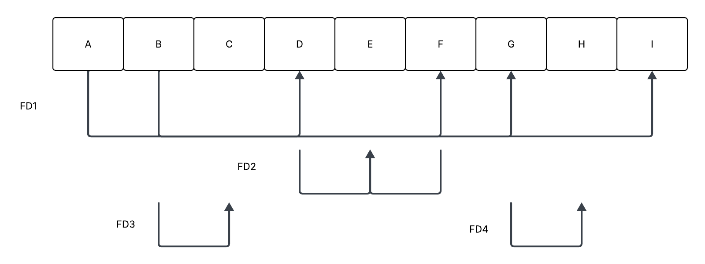
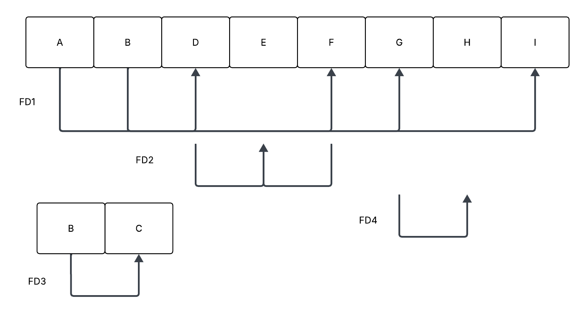
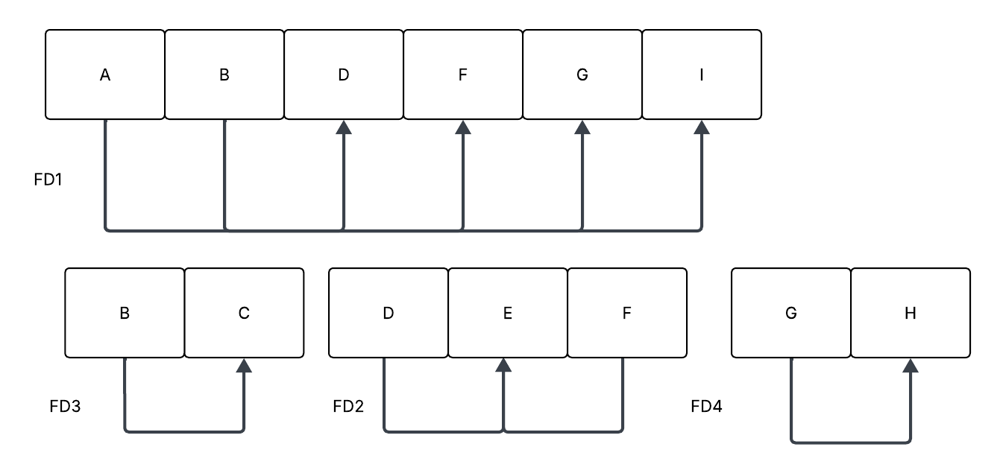
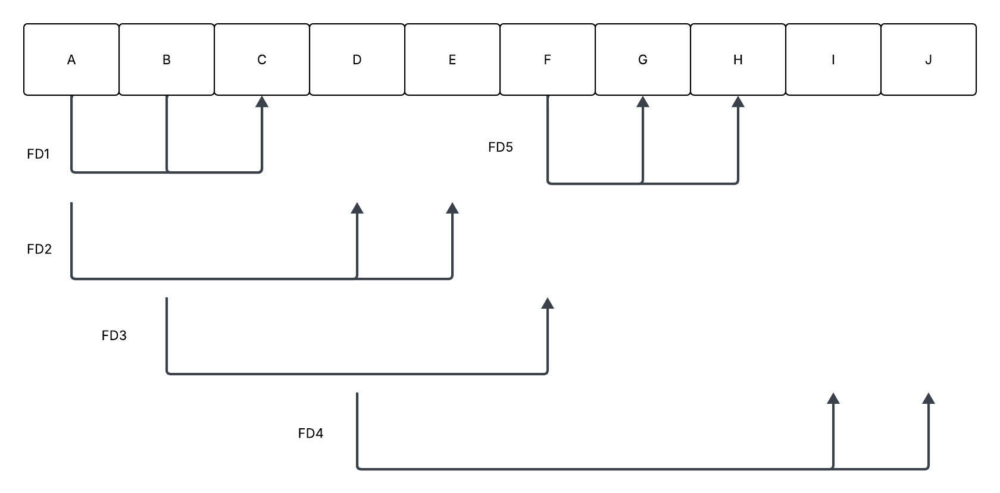
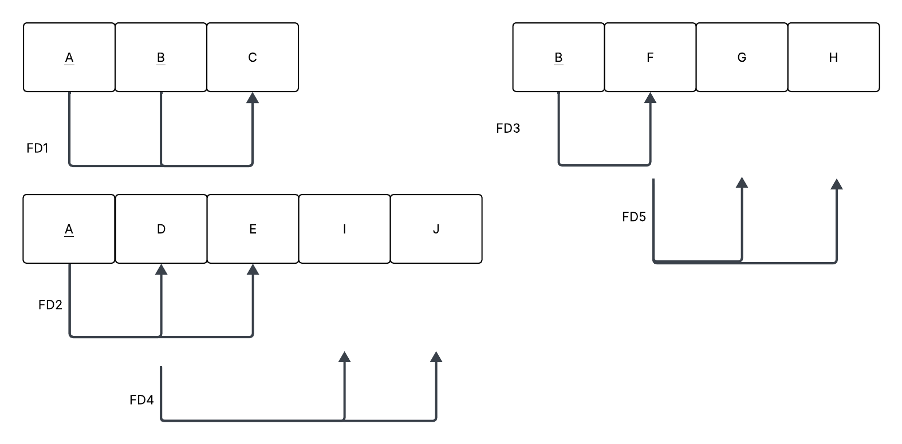
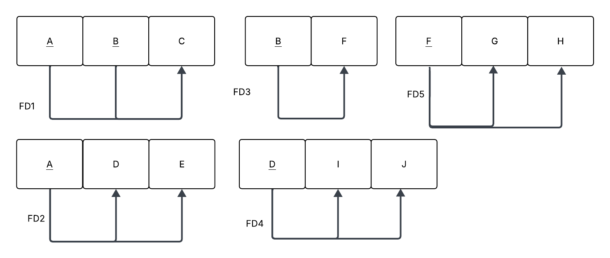
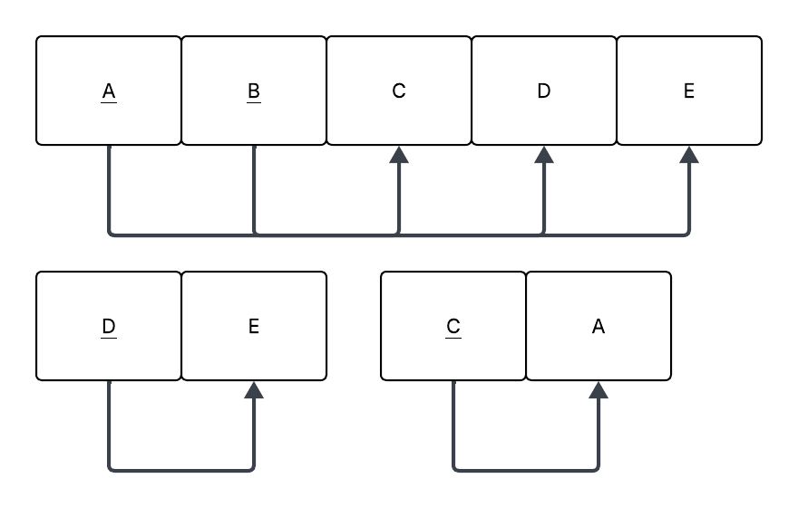
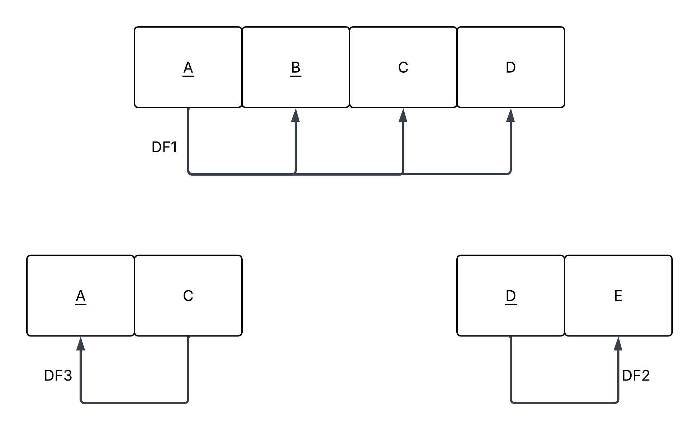
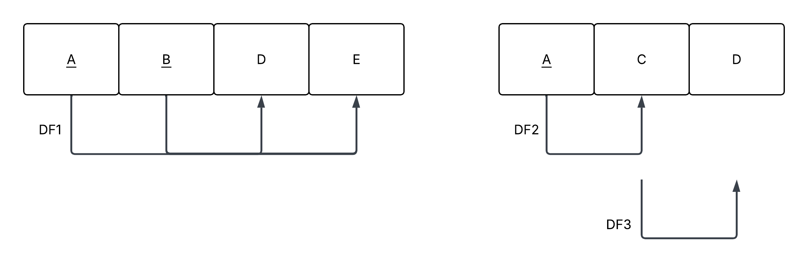
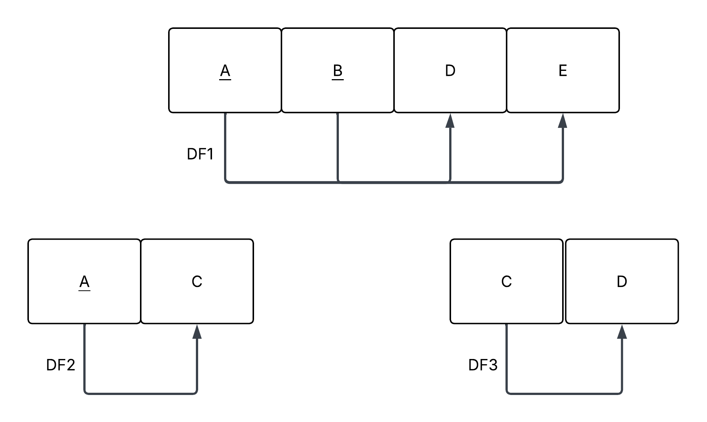

# BD: Guião 7


## ​7.2 
 
### *a)*

```
A relação esta na forma normal 1, porque tem dependências parciais e transitivas.
```

### *b)* 

```
A -> Titulo_Livro
B -> Nome_autor
C -> Afiliacao_autor
D -> Tipo_Livro
E -> Preco
F -> No_paginas
G -> Editor
H -> Endereco_editor
I -> Ano_publicacao
```




## ​7.3
 
### *a)*

```
A chave de R é {A, B}. Porque todos os elementos dependem destes atributos, e estes não dependem de nenhum.
```


### *b)* 




### *c)* 




## ​7.4
 
### *a)*

```
A chave de R é {B}.
```


### *b)* 




### *c)* 




## ​7.5
 
### *a)*

```
A chave de R é {A,B}.
```

### *b)* 




### *c)* 


### *d)* 


