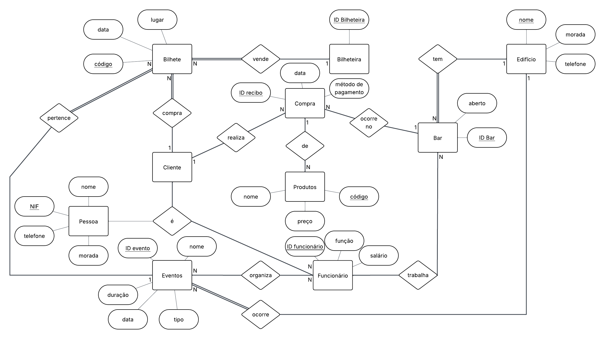
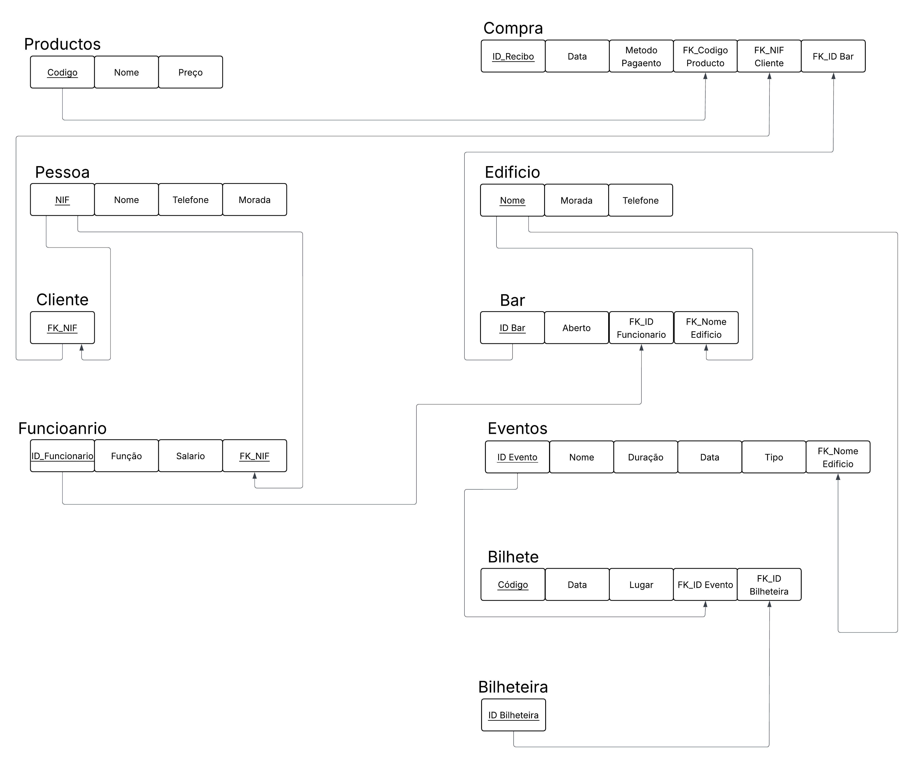

# BD: Trabalho Prático APFE

**Grupo**: P2G9
- Daniel Oliveira, MEC: 115359
- Ricardo Carmo, MEC: 112657

## Introdução / Introduction
 
Neste trabalho desenvolvemos um sistema de base de dados para um Cineteatro que gere eventos, bilheteira, bar e recursos humanos.

## ​Análise de Requisitos / Requirements

## Funcionais
- **Gestão de Pessoas**: Registo de clientes e funcionários com dados pessoais partilhados (NIF, nome, contacto, morada)
- **Eventos**: Criação e gestão de espectáculos com duração, data, tipo e local
- **Bilheteira**: Emissão de bilhetes por funcionário da bilheteira para eventos específicos
- **Bar**: Venda de produtos com registo de compras por cliente e funcionário responsável
- **Recursos Humanos**: Atribuição de funcionários a bares e eventos de organização

## Não-Funcionais
- **Integridade**: Chaves estrangeiras garantem consistência entre entidades
- **Escalabilidade**: IDENTITY para auto-incremento de IDs
- **Normalização**: 3NF evitando redundâncias e anomalias
- **Performance**: Tipos de dados otimizados (DECIMAL para preços, VARCHAR adequados)

## Entidades Principais
| Entidade | Responsabilidade |
|----------|------------------|
| Pessoa | Dados pessoais base |
| Cliente | Herda de Pessoa |
| Funcionário | Herda de Pessoa + função/salário |
| Evento | Espectáculo com artistas múltiplos |
| Bilhete | Emissão para eventos |
| Compra | Vendas no bar |
| Bar | Localização física + stock |

## DER

## ER

